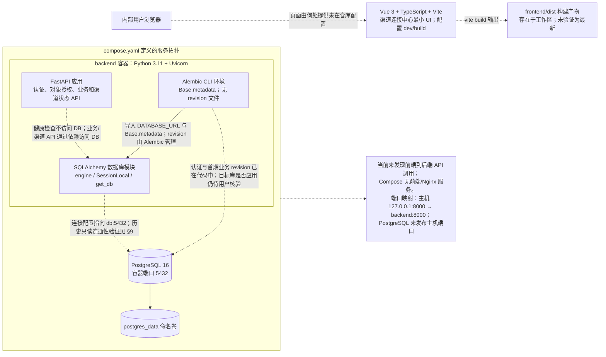
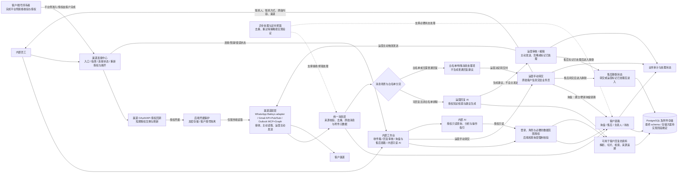

# 系统架构基线与开发规范

> **文档状态：当前架构基线草案。** 本文依据 `PROJECT_SPEC.md`、`docs/handoff/day1-scope.md`、`docs/handoff/day1-unknowns.md` 及已确认对话整理。它描述目标逻辑边界，不证明任何组件、接口、服务或数据流已经实现、部署或验证。
>
> **核对日期：2026-10-21（渠道接入策略更新：2026-10-27）**
>
> **当前首期边界（用户明确确认，2026-10-21，渠道接入策略后续调整）：** WhatsApp、Gmail、Outlook 首期均提供连接入口、客户侧前置条件指南及安全连接管理；客户负责平台准入/授权，系统不保证所有地区或账号都能接通。真实入站与最终出站按具备资格且完成授权的客户账号分别验收；平台阻塞如实呈现，不用模拟结果冒充接通，也不规避平台/地区限制。当前连接 MVP 先验证实际连通性/入站，不发送测试出站消息；项目最终仍需验收运营主动出站。其余首期聚焦运营消息处理、回复建议与人工审核发送、手动转交、询盘/售后链路状态和只读内部 AI。详见 [PROJECT_SPEC.md §1.1](../PROJECT_SPEC.md#11-当前首期开发边界2026-10-21)。
>
> **渠道实现基线（依据 [docs/external-channel-integration.md](external-channel-integration.md)，用户更新：2026-10-28）：** WhatsApp 不走 OAuth；采用项目自有独立 `WhatsApp Web + Baileys` adapter，账号所有者通过项目连接入口获取短时 QR 并扫码绑定关联设备，adapter 负责加密 auth state、连接、重连和入站事件。Gmail 由本项目直接完成 Google OAuth，使用 Gmail API、Gmail Watch、Google Pub/Sub、History API 和 Message API。Outlook 不采用当前仓库内置 IMAP watcher；通过外部 Outlook MCP Server 使用 Microsoft Graph 和 Entra OAuth 个人委派授权，按用户主动读取，不做后台长期无人值守。该方案是当前架构决策，不代表 adapter、Google OAuth、MCP、账号授权或真实渠道已验收。

## 1. 架构总览（当前实现与目标逻辑）

本节把**当前代码结构**和**目标逻辑架构**分开呈现。当前实现图只表示仓库中可核实的组件与连接；目标图表示需求及已确认边界，不代表功能已实现、部署或验证。目标图不细化尚未确认的 Agent 模型、节点和调用顺序。当前图依据工作区源码和配置静态核对，不能据此判断服务此刻是否运行。

### 当前代码实现（仓库静态核对）



- **代码依据：** [frontend/src/main.ts](../frontend/src/main.ts)、[frontend/package.json](../frontend/package.json)、[backend/app/main.py](../backend/app/main.py)、[backend/app/database.py](../backend/app/database.py)、[backend/app/models/base.py](../backend/app/models/base.py)、[backend/migrations/env.py](../backend/migrations/env.py)、[compose.yaml](../compose.yaml)、[backend/Dockerfile](../backend/Dockerfile)。
- `compose.yaml` 将 backend 的容器 8000 端口绑定到主机 `127.0.0.1:8000`；PostgreSQL 没有主机端口映射，数据目录使用 `postgres_data` 命名卷，并配置 `pg_isready` 健康检查。配置文件存在不代表本次核对时容器正在运行。
- [backend/tests/test_health.py](../backend/tests/test_health.py) 和 [backend/tests/test_database_config.py](../backend/tests/test_database_config.py) 覆盖健康响应及连接配置/会话关闭；不覆盖业务 CRUD。数据库连接曾有用户提供的只读验证记录，详见 §9；这不表示 `/health` 检查数据库或业务路由已使用数据库。
- 前端目录已有 Vite 项目配置及 `dev`/`build` 脚本；本次仅静态检查源码，未运行前端或验证构建产物。

### 目标项目逻辑架构（需求与已确认边界）

> **目标图，不是当前运行拓扑。** 图中项目内部组件均为目标能力，尚未在当前代码实现；虚线箭头仅表示目标支撑关系。图仅表达逻辑职责和有依据的主要流向，不定义最终部署拓扑、数据 schema、接口合同或模型调用关系。



- 首期边界来源见 [PROJECT_SPEC.md §1.1](../PROJECT_SPEC.md#11-当前首期开发边界2026-10-21) 及 §§3–5；三个渠道均需提供连接入口、指南和安全连接管理，但真实接入依赖客户平台资格与授权，按账号分别验收。Vue Flow 不在首期范围，普通页面状态足以呈现客户业务链路；客户链路展示与 Agent 节点动态画布是不同能力。
- 回复 AI 与内部 AI 职责分离：前者生成需运营审核的客户回复建议；后者只做授权范围内查询、分析及操作指引，不执行写操作。内部 AI 的操作类意图可给出页面入口和步骤，由员工自行操作。
- 询盘转交由运营手动触发，转交数据保留联系人、联系方式、客户原始内容和来源渠道；售后在转交业务或运营标记已处理后进入静默期。静默期长度、新消息到达后的处理与恢复规则仍待实现前确认。
- 首期不建设部门内部作业系统、合同管理/OCR、统计报表或自动发送。业务员查看转交客户的必要原始信息和链路状态，不等于建设其完整作业工作台。
- **尚未实现或尚待环境验收（按当前仓库与用户环境分层核对）：** 三渠道真实入站主链路已按 Day 6 分渠道记录；仍待真实 provider 重放、撤销/断开恢复、附件和长期运行专项。知识资料上传/ACL/持久化 chunk、embedding、pgvector、关键词/向量检索、RAG、回复建议、人工审批/出站发送、生产调度、SSE、完整审计保留生命周期、附件实际存储和跨进程专项仍未完成。当前工作区已实现认证与会话、首期对象授权、渠道状态与三渠道入站路径、统一消息入库、中文概要代码闭环、原文安全回源、运营收件箱、询盘时间线、手动转交、人工状态、内存资料清洗/切片和前端“我的”/运营工作台；目标 PostgreSQL 最新用户记录为 `0012_message_overviews`，具体运行版本以最新 handoff 为准。代码、隔离测试和目标 schema 证据需与真实 provider/浏览器证据分层表达。图中的逻辑连线不是接口或调用合同。

### 当前骨架与目标能力差距

| 领域 | 当前仓库证据 | 当前状态 |
|---|---|---|
| 前端 | [frontend/src/main.ts](../frontend/src/main.ts)、[frontend/src/App.vue](../frontend/src/App.vue)、[frontend/src/api/channels.ts](../frontend/src/api/channels.ts)、[frontend/src/api/inbox.ts](../frontend/src/api/inbox.ts) | Vue/Vite “我的”渠道管理、收件箱/客户链路详情、原文预览/展开、人工状态和只读分析；前端单元测试/生产构建已有 Day 8 证据，目标浏览器异常路径按 handoff 保留 |
| 后端 API | [backend/app/main.py](../backend/app/main.py)、[backend/app/channel_routes.py](../backend/app/channel_routes.py)、[backend/app/business_routes.py](../backend/app/business_routes.py) | 认证、首期对象授权、渠道目录/账号状态、三渠道入站、收件箱/询盘查询、原文回源、中文概要和内部只读分析 API；回复建议、RAG 和出站未实现 |
| 数据库连接 | [backend/app/database.py](../backend/app/database.py)、[compose.yaml](../compose.yaml) | SQLAlchemy PostgreSQL/Compose PostgreSQL；用户最新 Day 8 记录核验目标库已到 `0012_message_overviews`，真实 provider 补充专项和并发证据仍分开记录 |
| 业务模型与迁移 | [backend/app/models/user.py](../backend/app/models/user.py)、[backend/app/models/business.py](../backend/app/models/business.py)、[backend/migrations/env.py](../backend/migrations/env.py)、[backend/migrations/versions/](../backend/migrations/versions/) | ORM/迁移包含认证、渠道账号/授权、询盘/附件/通知、消息/消息附件、InquiryEvent、人工状态、外部账号映射和 `message_overviews`；目标 schema 以最新用户 handoff 为准 |
| 认证与授权 | [backend/app/auth.py](../backend/app/auth.py)、[backend/app/authorization.py](../backend/app/authorization.py) | 服务端 session/CSRF/Argon2、首期对象授权、消息/询盘/timeline/转交/原文/概要范围测试；完整 RBAC、部门/经理权限未实现 |
| 渠道与消息处理 | [backend/app/channels/](../backend/app/channels/)、[backend/app/channel_routes.py](../backend/app/channel_routes.py)、[backend/app/channels/inbound.py](../backend/app/channels/inbound.py)、[backend/app/message_ingestion.py](../backend/app/message_ingestion.py) | provider-specific/provider-neutral 入站、统一消息幂等、原文安全回源和失败回退已实现；真实 provider 重放、撤销恢复、附件、长期运行和出站仍待专项验收 |
| Agent、知识检索与报价 | backend 源码及依赖清单 | 未发现 Agent、RAG、产品/报价工具实现 |
| 队列、调度与 SSE | backend 源码及依赖清单 | 未发现 worker、定时抓取、重试队列或 SSE 端点 |
| 审计、提醒与生命周期 | backend 源码 | 未发现业务审计事件、提醒、归档或清理任务 |
| 部署 | [backend/Dockerfile](../backend/Dockerfile)、[compose.yaml](../compose.yaml) | 当前 Compose 只有 backend 与 PostgreSQL；无前端/Nginx/HTTPS 服务配置。生产部署仍是目标要求 |

## 1.1 当前首期边界（用户明确确认，2026-10-21）

> 本节用于覆盖目标逻辑图及后续章节中与首期范围冲突的宽泛原始基线；不是实现状态声明。详细清单见 [PROJECT_SPEC.md §1.1](../PROJECT_SPEC.md#11-当前首期开发边界2026-10-21)。

- **三渠道连接能力（首期）：** WhatsApp、Gmail、Outlook 均提供连接入口、客户侧前置条件指南及安全连接管理。客户完成其平台资格核验、平台侧注册/验证和授权；系统负责应用集成、凭据安全处理、账号隔离、连接测试和状态呈现。真实渠道仅对具备资格且授权的账号标记为连接/验收通过；平台或地区准入阻塞须如实呈现，不规避限制、不以模拟结果冒充真实接入。当前连接 MVP 验证入站/连通性，不发送测试出站消息；项目最终仍需对可用账号验证运营主动出站。
- **运营回复 AI：** 对适用消息检索有权限且标记为可用于客户回复的知识资料，生成客户语言回复建议及供运营审核的内容；运营审核/编辑后主动发送。AI 不发送、不审批。
- **内部 AI：** 只进行当前用户授权范围内的查询和分析；对操作意图提供操作步骤及页面入口，不执行任何业务写操作。后端负责授权和数据读写，不能依赖 Prompt 执行安全控制。
- **运营转交与链路：** 运营手动转交客户给业务员，保留并展示联系人、联系方式、原始内容、来源渠道等必要信息。询盘建立并维护询盘链路；售后在转交业务或运营标记已处理后进入静默期。静默时长、新消息策略和恢复条件待确认。
- **知识处理：** 仅把经过授权、标记可用于客户回复的资料用于回复检索；按需要解析、切片、索引并保留来源。客户原始消息和业务记录不自动并入知识库。
- **首期明确排除：** Vue Flow 动态画布、内部 AI 写操作、自动发送/自动审批、通用自然语言操作平台、合同管理/OCR、部门内部作业与排班、统计报表、复杂自动回复策略、外网搜索、其他部门专属 Agent。客户链路用普通页面状态或清单展示，不依赖 Vue Flow。
- **不可误删的必要支撑：** 业务员需查看运营转交的必要原始客户信息和链路状态；这不扩大为部门内部作业系统。认证和必要的数据范围授权仍须实现，授权粒度以首期实际角色和数据为界。

## 2. 标注规则与使用边界

- **【原始基线】**：`PROJECT_SPEC.md` 已记录的项目基线，不代表已实现。
- **【用户明确确认】**：对话中已经确认的方向或边界。
- **【建议（非决定）】**：便于开发组织的建议，不是用户决定。
- **【待我确认】**：仍需用户决定的事项，不作推断。
- **【实现前验证】**：方向已有依据，但需在真实接口、代码或运行环境中确认具体细节。

本文不定义完整业务模型、最终权限矩阵、部署拓扑、最终接口合同或未确认的模型调用关系。设计、实现、验证分别记录；没有代码、测试或运行证据的能力不得写成已完成。

## 3. 系统边界

### 3.1 系统内

- **【原始基线】** 面向内部员工提供统一收件箱、消息处理、知识检索、回复审核、询盘转交、链路记录、审计和 Agent 执行状态展示。[`PROJECT_SPEC.md §1、§8`](../PROJECT_SPEC.md#1-项目目标)
- **【用户明确确认】** WhatsApp、Gmail、Outlook 首期均需提供连接入口、客户侧指南和安全连接管理；客户自行完成平台资格/注册/授权，系统提供应用侧连接与状态验证。真实接入按已获资格且完成授权的客户账号分别验收；平台/地区阻塞须明确显示，不能以模拟结果冒充真实接入。当前连接 MVP 不测试出站，但项目最终仍需验证运营主动出站。
- **【用户明确确认】** 常规接待中 Agent 只生成回复建议；运营审核后主动点击发送、忽略或标记已处理。Agent 不决定发送。[`day1-scope.md §1、§2.1`](handoff/day1-scope.md#1-目标)
- **【用户明确确认】** 首期不建设工程、采购、生产部门内部作业系统、排班或专属 Agent；业务员仅查看运营转交的必要原始客户资料和链路状态。首期不含合同管理/OCR。此范围调整不表示后续资料记录需求被永久删除。

### 3.2 系统外

- **【原始基线】** 官网 AI 对话框、面向任意访客的开放式 Agent。
- **【用户明确确认】** 已有业务员负责后的客户跟进、回复和发送。业务员通过项目外的 WhatsApp、微信或邮件联系客户。
- **【用户明确确认】** 外部生产、库存、物流系统集成、合同 OCR、更多渠道扩展。
- **【用户明确确认】** 通过外网搜索获取物流、库存或产品独特信息。
- **【原始基线】** Agent 不负责成交后的工程、生产跟进；具体内部作业由员工在项目外或按项目记录处理。[`PROJECT_SPEC.md §15、§13 P2`](../PROJECT_SPEC.md#13-优先级范围)

## 4. 逻辑组件职责

### 4.1 渠道连接、适配与统一消息层

- **【首期目标】** 内部员工从“我的 > 接入渠道”进入 WhatsApp、Gmail、Outlook 连接入口；运营人员使用公司派发的个人工作渠道账号，并在管理员授予的渠道类型/范围内自行连接、查看、重新授权和断开本人账号。系统账号由管理员创建分发，不提供自助注册。账号所有者负责平台资格及平台侧授权/业务资产准备；产品侧负责自有 OAuth/开发者应用配置、集成、状态和连接检查。入口/指南不代表账号已连接。
- **【安全边界】** 授权凭据仅经 HTTPS 到达后端并加密存储，按内部用户/渠道账号隔离；浏览器不持有长期令牌，日志/URL/分析追踪不暴露凭据。执行最小权限，提供重新授权和断开/撤销指引。密钥管理、令牌刷新、删除/撤销语义及员工离职后的账号转移/历史保留须实现前验证。
- **【原始基线】** 接收或抓取消息，验证来源，去重，保存原始消息与附件元数据，并按渠道身份关联客户/会话。[`PROJECT_SPEC.md §4.3`](../PROJECT_SPEC.md#43-消息接收与存储)
- **【用户明确确认】** 已连接的 WhatsApp、Gmail、Outlook 账号均通过统一输入/输出抽象进入内部处理链路；账号准入由客户完成，真实接通以账号级证据为准。
- **【实现前验证】** 统一字段、附件映射、错误表示、发送回执和账号作用域须以真实 MVP 接口验证为依据；当前不预设最终字段合同。[`day1-unknowns.md §3`](handoff/day1-unknowns.md#3)
- **【用户明确确认，2026-10-21】** 管理员创建内部账号并配置个人可接入的渠道范围；运营人员可在该范围内自行连接和管理本人工作渠道账号，且仅处理本人账号消息。固定发件人白名单由管理员维护。该规则覆盖原先渠道账号统一由管理员配置/解绑的描述；后台权限尚未实现。见 [`PROJECT_SPEC.md §3.1`](../PROJECT_SPEC.md#31-已确认的授权设计尚非实现)。

**建议（非决定）**：渠道连接中心负责连接入口/指南、OAuth 回调或平台授权状态、连接测试、重新授权/断开及连接状态展示；凭据仅由后端安全保存并按客户账号隔离。渠道适配器负责已授权凭据下的 API 调用/来源校验、收发、格式转换和错误转换；会话关联、权限、Agent 路由和人工审核保持在渠道无关层。具体租户模型、OAuth token 生命周期和密钥管理实现仍须设计验证，不能让浏览器直接持有长期令牌。

### 4.2 调度与未读抓取

- **【用户明确确认】** 时区为 UTC+8；当前抓取时点为 08:00、09:30、11:00、14:00、15:30、17:00，不含 12:00、18:00。
- **【用户明确确认】** 星期日及中国大陆法定节假日不抓取；管理员可以修改抓取安排。
- **【用户明确确认】** 每次处理未读信息；静默时间不等于已处理，也不应只处理静默期间新出现的信息。
- **【实现前验证】** 日历来源、账号级调度、修改后的生效规则、重复抓取和失败恢复须在实现时验证。原始基线仅规定邮箱定时抓取，不规定具体调度实现。[`day1-scope.md §2.1`](handoff/day1-scope.md#21-渠道与抓取安排)

### 4.3 消息、会话与客户链路

- **【原始基线】** 消息至少保留渠道、外部消息 ID、会话、方向、状态和时间戳；外部消息 ID 用于去重；发送结果保留渠道消息 ID、失败原因和重试次数。[`PROJECT_SPEC.md §4.3`](../PROJECT_SPEC.md#43-消息接收与存储)
- **【原始基线】** 系统保存询盘、负责人和跟进状态。[`PROJECT_SPEC.md §7.1`](../PROJECT_SPEC.md#71-运营转交业务)
- **【用户明确确认】** 询盘应建立客户链路并记录负责人/状态；运营手动转交业务员，转交内容保留联系人、联系方式、原始内容和来源渠道。售后在转交业务或运营标记已处理后进入静默期；静默不是删除。静默长度、静默期间新消息及恢复条件待确认。
- **【用户明确确认】** Agent 不决定询盘转交、客户链路负责人或状态变化；转交由运营通过页面操作完成。
- **【用户明确确认】** 账号注销或人员变更不自动清空链路。
- **【实现前验证】** 失效 30 天后的“清空”含义，以及账号变更后的历史消息、资料和审计记录保留/选择性清理范围尚未确定。[`day1-unknowns.md §2、§4`](handoff/day1-unknowns.md#2)

### 4.4 Agent、工具与知识检索

- **【用户明确确认】** 首期包含两个用途分离的 AI：运营回复 AI 对适用客户消息检索授权知识并生成需人工审核的回复建议；内部 AI 只做用户授权范围内的只读查询、分析和操作指引，可提示目标页面/步骤，但不执行写操作。
- **【首期排除】** 首期不建设通用自然语言操作 Agent、自动发送/审批、其他部门专属 Agent；产品/有效报价查询仅在对应真实数据、授权和首期验收范围明确后纳入，不由原始基线自动推定为已包含。
- **【用户明确确认】** 回复 AI 仅使用有权限且标记为“可用于客户回复”的资料；该资料需按需要解析、切片、索引/检索并保留来源。客户原始消息及业务记录不自动并入回复知识库。更细的资料类型、格式和切片策略在实现阶段验证。
- **【首期排除】** 外网搜索不纳入首期。是否作为后续能力另行确认。
- **【实现前验证】** 回复 AI 无资料依据、无法判断或模型调用失败时的处理项、提示和升级路径需定义；不得生成无来源依据的确定性客户答复。内部 AI 无法回答或权限不足时应拒绝/提示，不以模型推断替代后端授权。
- **【首期边界】** 不要求 LangGraph 或特定多节点编排；依据实际流程选择简单可测试的实现。移除 Vue Flow 仅移除前端画布，不自动决定后端编排技术。

### 4.5 人工审核与出站发送

- **【用户明确确认】** 常规消息由 Agent 生成建议，运营审核并主动点击发送、忽略或标记已处理。
- **【原始基线】** 建议回复使用客户消息语言，并向运营展示中文翻译；发送状态、失败原因和处理记录需要保存。[`PROJECT_SPEC.md §5.3`](../PROJECT_SPEC.md#53-建议回复与人工审核)
- **【用户明确确认】** 已有业务员负责的客户不生成回复建议、不通过项目发送；业务员在项目外沟通。
- **【实现前验证】** “标记已处理”、忽略与渠道已读状态之间的最终映射，以及发送幂等、重试和失败人工处理尚未确定。

### 4.6 特殊场景路由

- **【用户明确确认】** 白名单内且运营不负责回复的消息不生成普通回复建议，而进入处理项/清单；运营可按业务流程人工处理或转交。
- **【实现前验证】** 白名单匹配字段、作用渠道、处理项状态、是否需要通知及各渠道特殊消息识别规则尚未确定；不得将群聊、表单邮件等历史特殊场景规则全部推定为首期必须实现。

### 4.7 内部资料与链路记录

- **【首期边界】** 不实现合同管理/OCR、工程/采购/生产内部作业、排班或生产单流程；必要的客户链路状态由普通页面展示。业务员可查看运营转交的必要原始客户信息和链路状态。
- **【实现前验证】** 转交信息字段的最小集合、业务员可见范围及询盘/售后链路状态映射需在实现阶段定义；不从旧的跨部门资料基线推导额外首期模块。

## 5. 有依据的数据流

```text
客户/账号所有者
  → 查阅分渠道指南并完成平台侧账号资格、应用/业务资产配置与授权
  → 从项目连接入口发起授权/配置
  → 后端安全保存授权并向工作台显示连接/待授权/阻塞/错误状态
  → 对已连接账号执行渠道接收或未读抓取
```

```text
WhatsApp / Gmail / Outlook
  → 对已连接账号执行渠道接收或未读抓取
  → 来源验证、去重、原始消息与附件元数据保存
  → 统一消息输入
  → 客户/会话/链路关联
  → 后台异步处理
```

- **依据：** `PROJECT_SPEC.md §1.1、§4.1、§4.3`；渠道连接策略调整后，客户平台准入与系统侧连接职责分离。该图为目标数据流，不表示 OAuth、存储或接收功能已实现。
- **实现前验证：** 统一字段、客户匹配、附件边界和异步实现未定；连接状态枚举、客户/账号隔离、凭据刷新/撤销和错误引导需要实际设计与测试。

```text
普通客户消息（非白名单排除）
  → 回复 AI 检索有权限且可用于客户回复的资料
  → 生成客户语言建议（含运营审核所需中文信息/来源）
  → 运营审核/编辑
  → 运营主动发送、忽略或标记已处理
  → 对应渠道输出
```

- **边界：** 仅对客户已完成平台准入并授权的账号执行真实接入验收；未连接/阻塞渠道可用于内部模拟测试，但不得标记真实通过。Agent 不自主发送；当前连接 MVP 不发出站测试消息，项目最终仍需验证运营主动发送。模型无依据时不得编造确定性答复，具体兜底状态待定义。

```text
白名单内且不由运营回复的消息
  → 创建处理项，不生成普通回复建议
  → 运营人工判断是否手动转交
  → 转交时业务员可查看联系人、联系方式、原始内容和来源渠道
```

```text
询盘 → 建立/更新询盘链路 → 运营手动转交给业务员
售后 → 运营转交业务 或 标记已处理 → 进入静默期
```

- **实现前验证：** 静默期长度、静默期间新消息处理及恢复规则待明确；静默不代表删除。

```text
内部 AI 请求
  → 后端按发起人授权查询数据
  → 只读分析/查询，或返回操作步骤及页面入口
  → 员工自行前往页面并提交表单
```

- **边界：** 内部 AI 不执行创建、修改、删除、改派或发送等写操作；权限拒绝由后端执行，不由 Prompt 代替。

## 6. 技术与安全开发规范

- **【首期技术范围】** 按 [PROJECT_SPEC.md §1.1、§10、§12–§13](../PROJECT_SPEC.md#11-当前首期开发边界2026-10-21) 执行：三渠道连接入口、客户指南及安全连接管理；客户平台准入与授权按账号完成，真实接入按实际可用账号验收，不能保证所有账号均可连接；两类 AI 分工；Vue Flow、SSE、LangGraph、pgvector 等不能仅因原始技术基线列出就被视为首期强制依赖。按实际需求和服务器资源验证后采用。
- **【Vue Flow / LangGraph】** Vue Flow 是前端 Agent 节点画布，首期排除；客户业务链路用普通 UI 表达。LangGraph 是后端编排框架，与 Vue Flow 独立；首期不强制采用 LangGraph，若真实流程需要持久化多步状态/恢复执行，再评估引入。
- **【AI 安全边界】** 回复 AI 只生成待运营审核建议；内部 AI 只读查询/分析和操作指引。所有数据读取经后端授权，所有消息发送须由有权限运营人员明确触发；内部 AI 不得触发业务写操作。
- **【性能边界】** 目标部署为 2 vCPU / 2 GiB RAM；先用单体 API、必要后台任务和 PostgreSQL 满足首期，避免未验证需求导致额外常驻服务。真实内存、并发和消息量需在实现/验收阶段测量，本文不预设容量结论。

- **【原始基线】** 技术基线包括 Vue 3/TypeScript/Element Plus、FastAPI/Pydantic、SQLAlchemy/Alembic、LangGraph、LangChain/RAG、PostgreSQL/pgvector、PostgreSQL 队列、SSE、Docker Compose/Nginx/HTTPS、pytest/HTTPX。[`PROJECT_SPEC.md §10`](../PROJECT_SPEC.md#10-技术架构基线)
- **【用户明确确认】** 前端采用 Vite 作为 Vue 3 + TypeScript 项目的开发服务器和构建工具；生产部署使用构建产物，由 Nginx 提供静态文件服务，不在生产环境运行 Vite 开发服务器。当前代码已有 Vue/Vite/TypeScript 最小入口与 `dev`/`build` 脚本，但本次未运行验证；生产 Nginx 静态服务尚未配置，见 §1 中的“当前骨架与目标能力差距”表。
- **【原始基线】** Webhook 快速确认，处理放入异步任务；需要去重、幂等、限流、异常重试和防止重复发送。[`PROJECT_SPEC.md §4.3`](../PROJECT_SPEC.md#43-消息接收与存储)
- **【原始基线】** 权限必须由后端和数据查询层强制执行，不能只依赖前端或 Prompt；需要对象级授权和审计。[`PROJECT_SPEC.md §3、§11`](../PROJECT_SPEC.md#3-用户与角色)
- **【用户明确确认】** 权限独立拆分、可解耦；管理员可新增角色并修改角色、个人和部门权限。具体权限项仍需实现前验证。
- **【原始基线】** 凭据加密保存、密钥使用环境变量、日志脱敏、数据库不直接暴露公网、支持备份与恢复。[`PROJECT_SPEC.md §11`](../PROJECT_SPEC.md#11-安全运行与部署要求)
- **【渠道连接方案与安全要求】** 具体 provider 方案遵循 [docs/external-channel-integration.md](external-channel-integration.md)：WhatsApp 使用独立 `whatsapp_web_baileys` Node adapter（WhatsApp Web + Baileys，不采用 Meta Cloud API）；Gmail 使用项目 Google OAuth + Gmail API + Watch/Pub/Sub；Outlook 使用外部 MCP + Microsoft Graph/Entra 个人委派授权，按用户主动读取，不做后台长期无人值守。凭据只经 HTTPS 到达后端并加密存储，按客户与渠道账号隔离，限制最小权限；支持连接状态查看、重新授权、撤销/断开。不得将 OAuth token、Baileys QR/auth state、MCP 凭据或密码放入浏览器 localStorage、URL、日志、分析事件或普通错误追踪。具体密钥管理、token 刷新/轮换、删除与撤销语义须实现前验证；手工粘贴长期 token 不作为默认连接流程。该规范不代表真实 provider 已配置或账号已验收。
- **【用户明确确认】** 不在文档、代码、测试数据或日志中记录 Token、密码、Client Secret、Access Token、Refresh Token 或客户敏感内容。

### 6.1 首期认证与授权边界及后续授权基线

> **首期已确认的最小边界（2026-10-21）：** 内部用户必须登录；账号由管理员创建分发，不开放注册；后端及数据查询层按用户身份、岗位和业务范围授权。管理员配置运营人员可接入的渠道范围；运营人员自行连接和管理本人工作账号，并仅处理本人获授权且已连接账号范围内的消息、可主动发送；业务员只查看分配给本人的转交客户必要信息及链路状态；内部 AI 查询完全受发起用户权限约束且只读。账号所有者完成官方平台资格/授权，产品负责自身应用安全集成。未授权访问拒绝。当前仓库虽已有基本登录及用户/会话迁移，但无岗位/渠道授权持久化、渠道连接模型/API 或业务迁移，不能将设计写作已实现/已测试。
>
> **后续基线说明：** 以下原有矩阵中的部门资料、经理授权、Agent 节点重跑、合同/成交资料、跨部门摘要及长周期清理等策略，不自动进入首期；只有相关后续模块被确认纳入范围时才适用。首期权限不应按该复杂矩阵提前扩张。

#### 首期全局规则

- 系统仅供已登录内部用户使用；“可用于客户回复”标记不开放匿名访问，也不替代用户读取授权。
- 回复 AI 与内部 AI 均不得扩大当前用户资源范围。数据查询在后端授权后执行；越权拒绝，不通过模型提示词控制权限。
- 运营人员仅在本人获授权且已连接的渠道账号范围内审核、编辑并主动发送客户消息；管理员和 Agent 不发送。管理员配置运营人员可接入的渠道范围，运营人员自行管理本人连接；账号所有者完成平台侧准入和授权。
- 业务员只能读取分配给本人的转交信息与必要链路状态；其首期页面不包含成交资料管理或部门内部作业。
- 内部 AI 只读。需要创建、修改、转交或发送时，AI 提供页面路径/步骤，由用户在正常授权的页面表单中操作。

#### 后续授权基线（不自动属于首期）

- 系统仅供已登录内部用户使用；资料“可用于客户回复”不开放匿名访问。
- 权限由后端和数据查询层在对象读取前强制校验。无权限时统一返回“没有权限访问”，不得通过对象是否存在或其他差异泄露信息；用户确认提示不能绕过授权拒绝。
- AI/Agent 按发起用户身份和权限执行，不扩展其资源或操作范围。请求先授权，只有授权通过后，涉及修改、删除或改派才要求确认；确认不是授权。
- 普通用户默认获得当前岗位部门权限；管理员可为个人配置多个部门/协作范围，未选部门不具备增删改查权。跨部门协作可配置并可由管理员关闭。
- 工程、采购、生产为并行部门；各部门内部资料、记录和排班相互隔离。无相应权限的其他部门负责人只看脱敏的业务链路/部门周期摘要，不能看内部细节。所选跨部门协作部门是否可看对方排班和内部记录仍**待确认**，当前不据此授予。
- 客户及链路详情需同时满足相关渠道、部门、负责人、客户和资料授权；无权用户仅可见明确允许的脱敏摘要，不因知道对象标识而获得详情。

#### 角色与操作范围

| 角色/授权 | 已确认的范围与操作 | 明确限制 |
|---|---|---|
| 运营人员（首期） | 可在管理员授予渠道范围内连接、查看、重新授权和断开本人工作账号；可查看本人已连接账号内 WhatsApp、Gmail、Outlook 消息；审阅/编辑回复建议、忽略、标记已处理、主动发送；手动转交客户给业务员。 | 不得管理他人渠道账号或白名单；不由 AI 自动发送或转交；账号所有者完成平台侧资格/授权。 |
| 业务员（首期） | 只读查看明确转交给本人的必要客户原始信息（联系人、联系方式、原始内容、来源渠道）及链路状态。 | 不在系统中持续跟进客户，不通过项目发送；成交资料、合同和部门业务写入不属于首期。 |
| 管理员 | 账号、角色、部门、个人授权、渠道配置、知识库、报价策略和审计的管理职责；可访问全公司询盘并执行除客户消息发送以外的操作，包括消息处置、改派和删除。管理员全域处理消息但不能发送。 | 不具有客户消息发送权；管理员操作不自动生成待办或风险通知。账号/链路删除和修改、改派均先授权后确认。 |
| 工程/采购/生产人员 | 默认仅访问当前岗位部门已授权的一般业务资源；本部门授权范围内可执行常规读写、资料上传/下载及访问本部门内部资料、记录、排班。成交后只向其他部门显示脱敏链路/周期摘要。 | 不能读取其他部门内部详情；负责人身份仅允许操作本人获授权节点，不自动授予其他节点或客户敏感资料详情。 |
| 管理员特别授权的个人（经理概念） | “经理”不是独立角色。管理员可给个人配置部门/资料范围和特定权限；改派仅在获授权范围内，来源链路与目标负责人/部门都必须在范围内。资料删除可另行按指定范围授权；节点重跑权限也按授予范围限制。 | 经理身份本身不扩权；改派权不含账号/询盘链路删除；未选部门无增删改查权。 |

#### 资源与专项规则

- **发送消息（首期）：**只有有权运营在其绑定渠道范围内主动触发；管理员及 Agent 不得发送，AI 建议不等于发送授权。
- **账号/询盘链路删除：**管理员可删除，其他人无此权；授权通过后需二次确认。资料删除是独立权限，可由管理员按范围特别授权，但不能借此删除账号或客户链路。
- **AI 操作边界（首期）：**内部 AI 只允许授权查询/分析与操作指引，不执行业务写操作；回复 AI 只生成建议。原基线中的节点重跑、流程回滚及资料修改等能力不属于首期。
- **资料标记：**仅“可用于 AI 客户回复”或“仅内部使用”两态；系统仍要求员工登录，标记不授予员工读取权。资料分类/标记由管理员管理；资料删除可独立授权。
- **审计：**PROJECT_SPEC 基线规定的消息处理、回复审阅/发送、失败等业务事件照常留痕；管理员额外操作只对高风险变更记审计，不生成待办/风险通知。每年 1 月 1 日清除上一自然年的审计记录。
- **链路生命周期：**失效 30 天自动归档；30–90 天为静默期，可由管理员或当前有权负责人/获授权经理重新启用，但不能跨其节点/部门权限；重启后重置 90 天删除倒计时。失效第 87 天提醒当前负责人，90 天永久删除整条客户业务链路及服务器关联附件。附件在归档时不删除，提醒负责人如需保留须联系管理员下载。清理范围、删除失败处理和备份介质同步清除仍需实现前定义/验证。

#### 角色/资源矩阵

> 下表是已确认政策的摘要，不表示授权执行代码已存在；未授予权限均拒绝。

| 角色/资源 | 读取范围 | 允许操作 | 明确禁止/限制 |
|---|---|---|---|
| 运营—渠道/消息/询盘 | 管理员授予类型范围内的本人 Gmail、Outlook、WhatsApp 工作账号及其消息/关联询盘 | 连接、查看、重新授权、断开本人账号；审阅/编辑回复建议、忽略、标记已处理、主动发送；在本人渠道范围转交 | 不管理他人渠道/白名单；不删除询盘链路；不自行改派已有负责人 |
| 业务员—询盘/成交资料 | 仅分配给本人的询盘及其详细客户/成交资料 | 处理询盘；读写成交信息；付款记录可为空或分期 | 不得删除询盘链路、不改派负责人；不因此获运营发送权 |
| 管理员—全局业务 | 全公司询盘及管理资源 | 账号/角色/部门/授权管理、渠道配置、知识库/报价/审计管理；全公司消息处置、改派、删除；除发送外可执行其他操作 | 不能发送客户消息；高风险变更先授权后确认；不生成待办/风险通知 |
| 工程/采购/生产—部门资料 | 默认当前岗位部门；部门内部记录/排班彼此隔离 | 授权范围内一般 CRUD、资料上传/下载；当前节点负责人可操作本人授权节点 | 未授权部门仅可见脱敏链路/状态/周期摘要；不能看别部门内部详情或无权客户资料 |
| 经理—个人叠加授权 | 管理员配置的部门/资料范围 | 仅获授的改派、节点重跑或资料删除等范围权限；改派来源与目标均须在授权范围 | 非独立角色；不因经理称谓扩权；改派权不含账号/询盘链路删除 |
| AI（首期） | 回复 AI 按授权检索客户回复资料；内部 AI 按发起人权限查询业务数据 | 生成回复建议、只读分析/查询、返回操作步骤与页面入口 | 不发送、不执行创建/修改/删除/改派；不绕过后端授权 |

#### 待确认及实现状态

1. **待确认：**被管理员选为跨部门协作对象的个人，是否可查看被选部门的内部排班/记录；在确认前仍按部门内部隔离处理。管理员可配置多选部门并关闭跨部门协作，未选部门无 CRUD 权。
2. **实现前定义：**字段级脱敏、各部门资料类型/字段和 AI 工具操作映射、归档/90 天永久删除任务及附件下载提醒的失败处理、备份介质清除保证。
3. **业务模型阶段确定：**成交/工程/采购/生产业务数据模型按功能开发阶段设计，不从权限矩阵自动推导 schema。
4. **未实现：**当前代码没有身份/权限表、认证与授权端点、角色策略、Agent 操作门控或业务迁移 revision；矩阵不代表这些功能通过测试。

**建议（非决定）**：实现顺序应先保留原始消息和审计信息，再进入统一映射、权限过滤和 Agent 处理；任何真实渠道结论都应区分“查阅资料、账号适用、授权完成、真实读取/发送成功”。

## 7. 待我确认与实现前验证

### 待我确认

1. Gmail、Outlook.com 与 WhatsApp Business Platform 的客户账号资格、地区可用性、平台注册/审核/计费要求及授权流程仍需逐渠道验证；账号准入由客户完成，产品提供指南和连接能力，不承诺准入结果，也不绕过限制。解绑后的历史数据影响仍需实现前验证；运营人员按管理员授予范围管理本人渠道连接；固定发件人白名单由管理员维护。

### 实现前验证 / 开发阶段确认

1. 三渠道按目标客户/地区核实账号资格、平台应用注册与授权、计费/审核要求及 OAuth/API/Webhook 条件；记录客户侧准入阻塞。真实入站与最终出站仅对已授权且实际可用的账号验收；连接 MVP 暂不发送出站测试消息。
2. 统一输入/输出字段、错误、附件和发送回执合同。
3. 失效链路 30 天后的清理语义。
4. 账号/人员变更后的历史数据保留与选择性清理范围。
5. 业务员负责、群聊、表单邮件和已成交邮件的识别条件。
6. 资料字段、访问范围、文件存储和哪些文件进入 RAG。
7. 具体角色权限项、个人/部门权限组合和状态映射。
8. Agent 的模型、节点、工具调用和失败升级关系。
9. 队列、调度、重试、SSE 事件合同及部署拓扑。

## 8. 文档演进规则

- 用户确认新方向后，更新架构基线和项目说明，并保留来源链接。
- 未确认事项继续标注 `【待我确认】`；默认方案必须写成 `建议（非决定）`。
- 已确认方向但尚未定实现细节，写成 `【实现前验证】` 或 `【开发阶段确认】`，不再误写成用户未确认，也不写成已实现。
- 详细 schema、接口合同、部署拓扑和模型调用关系在实际设计阶段形成，不从本文件补造。
- 实现状态只依据代码、测试、运行输出或交接验证记录填写。

## 9. 数据库连接与迁移验证记录

> 本节依据用户在 2026-10-20 对话中提供的当前源码检查及服务器终端输出整理；助手未在服务器执行这些命令。这里只记录证据覆盖的范围，不把空迁移或 Alembic 元数据表写成业务 schema 已完成。

### 8.1 FastAPI 后端应用级连接

- **结果：已验证（SQLAlchemy engine 只读连接探测）**。
- **用户提供的命令：** `docker compose exec backend python -c "from sqlalchemy import text; from app.database import engine; print(engine.connect().execute(text('SELECT 1')).scalar())"`
- **实际输出：** `1`。
- **结论边界：** 证明 backend 容器中的 Python 进程通过 `app.database.engine` 连接 PostgreSQL 并执行只读 `SELECT 1`。未证明 HTTP 路由使用数据库会话，也未验证业务 CRUD、身份认证或授权。

### 8.2 Alembic 迁移应用

- **迁移配置：** 用户检查的容器文件 `/app/alembic.ini` 最初含拼写错误的 `[alemibic]` section；后续重建后输出为 `[alembic]`，包含 `script_location = migrations` 和 `prepend_sys_path = .`。`/app/migrations` 中用户检查到的文件只有 `env.py`，没有 `versions/` 迁移脚本。
- **命令结果：** 用户提供的后续 `docker compose exec backend alembic upgrade head` 未显示错误并返回 shell 提示符；在无 revision 脚本的现状下，这只表示命令未报错完成，不能证明有业务迁移被应用。
- **实际 revision 证据：** 用户执行 `docker compose exec backend alembic current` 未见 revision 输出；`docker compose exec backend alembic heads` 也未见 head 输出。数据库查询 `SELECT * FROM alembic_version;` 返回 `(0 rows)`。
- **结论：迁移应用状态为未完成业务 schema／无已应用 revision。** 数据库中存在 `public.alembic_version` 表，但其 `version_num` 为空；未发现可应用的迁移版本。不能将 `upgrade head` 无报错单独记录为迁移已应用。

### 8.3 Schema 检查

- **用户提供的检查：** `\\dt` 只列出 `public.alembic_version`；`\\d alembic_version` 显示其仅含非空 `version_num character varying(32)` 主键列；`SELECT * FROM alembic_version;` 为 0 行。
- **额外检查：** `\\d your_table` 返回 `Did not find any relation named "your_table"`。这是对字面占位符名称的检查，不是对某个已确认业务表的检查。
- **结论：** 目前的实际 schema 证据仅支持 Alembic 元数据表存在且没有当前 revision；没有证据显示身份或其他业务表已创建。用户明确当前没有身份表和权限表，计划在后续实际开发中补充；不据此补造或声称存在任何业务 schema。

### 8.4 迁移回退

- **结果：未验证**。
- **用户提供的命令：** `docker compose exec backend alembic downgrade -1` 返回 `FAILED: Relative revision -1 didn't produce 1 migrations`。
- **解释：** 当前没有迁移 revision 可供相对回退；该错误反映没有可回退的迁移版本，不是用户操作错误，也不能证明回退功能成功或失败。
- **状态：** 迁移回退未验证完成。待有经审阅并应用的迁移 revision 后，才可在确认目标数据库与数据影响、具备恢复方案的条件下设计和验证回退；当前不要重复执行 `downgrade -1` 来制造验证结果。

### 8.5 后续验证补充（用户提供，2026-10-20）

- 用户从项目根目录执行 `python -m pip install -r requirements.txt` 失败，原因是根目录没有该文件；进入 `backend/` 后运行 `python -m pip install -r requirements.txt` 成功，记录退出状态为 0。安装输出报告 SQLAlchemy 2.1.5、Psycopg 3.3.6、Alembic 1.20.0、pytest 8.4.2。该结果只证明当次服务器 `.venv` 中依赖安装成功，不代表容器依赖版本锁定。
- 用户提供的 `.env` 检查结果：`git check-ignore -v .env` 命中根 `.gitignore` 第 1 行；`git ls-files --error-unmatch .env` 返回 1；`git status --short --ignored -- .env` 显示 `!! .env`。据此该服务器工作树中的 `.env` 被忽略且未被 Git 跟踪；未检查或记录其内容。
- 用户执行 `docker compose up -d --build db backend` 后，`docker compose ps` 显示 backend Running、db Healthy；backend 日志显示 Uvicorn 启动。该输出是该次检查时的服务状态，不保证后续仍运行。
- 用户再次执行 `docker compose exec backend python -m alembic upgrade head`，并记录退出状态 0；`python -m alembic current` 退出状态 0但无 revision 输出；只读 SQL `SELECT version_num FROM alembic_version` 退出状态 0并返回 `(0 rows)`。结合迁移目录只有 `env.py`、没有 revision 文件，此结果**不构成业务迁移已应用的证据**。
- 用户明确说明当前实际 schema 中**没有身份表和权限表**，计划在后续实际开发过程中补充。当前没有身份/权限业务表，是未实现的业务 schema，不是用户操作错误；具体字段和关系不在本记录中臆造。
- 当前记录的 `alembic_version` 表为 Alembic 自身的版本跟踪表，不是身份表或权限表；表存在且查询 0 行不代表业务迁移已完成。
- **迁移回退仍为未验证完成**：当前没有业务 revision，因此没有可执行的回退目标；此前 `downgrade -1` 的报错是没有可回退迁移的结果，不代表用户操作错误，也不能记作回退通过。

### 8.6 数据卷操作记录与注意事项

- 用户提供的 `docker compose down -v` 输出明确显示移除了容器 `enterprise-agent-db-1`、`enterprise-agent-backend-1`、命名卷 `enterprise-agent_postgres_data` 和网络；随后 `docker compose up -d db` 创建了同名的新卷。
- **影响：**旧命名卷已被删除，新卷为空。若旧卷中存在需要保留的数据，该数据随卷删除；当前记录没有证据证明旧卷曾包含有效业务数据或存在可用备份。`down -v` 是有数据删除影响的操作，不应作为普通重启步骤。
